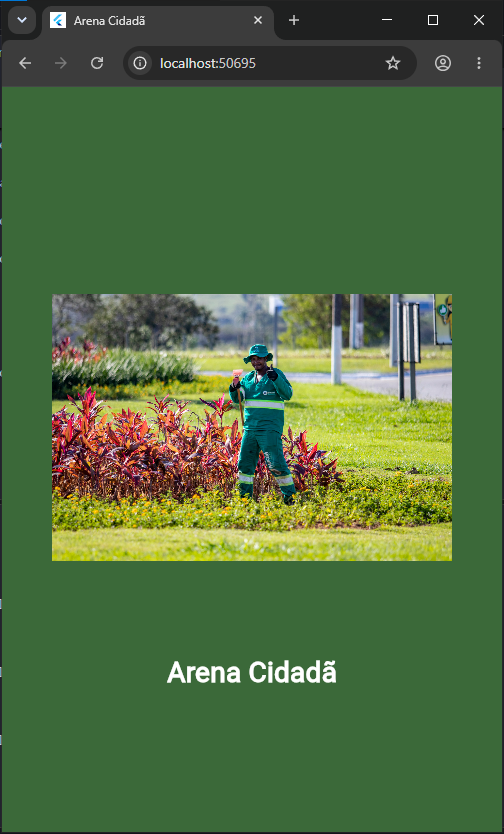
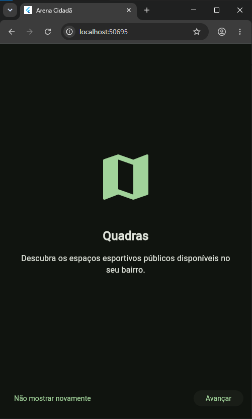
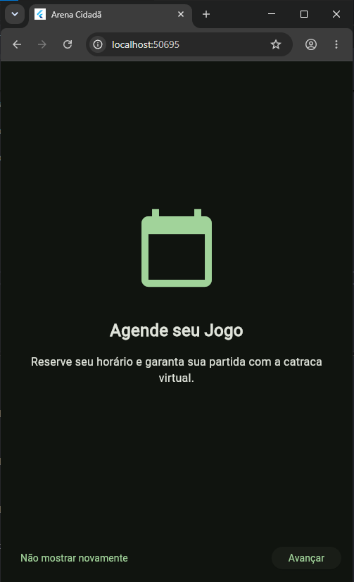
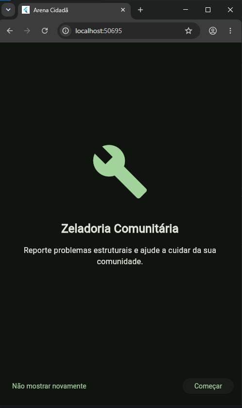
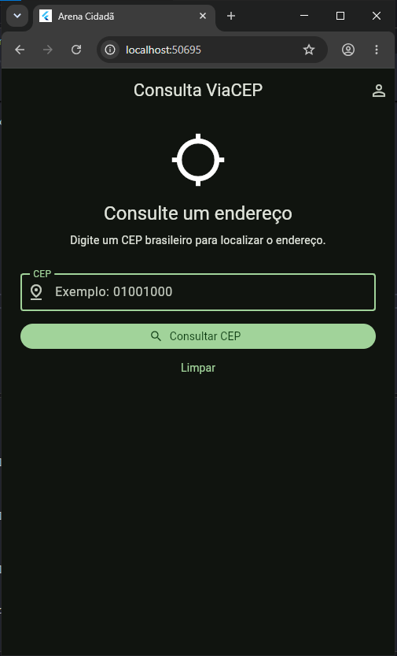
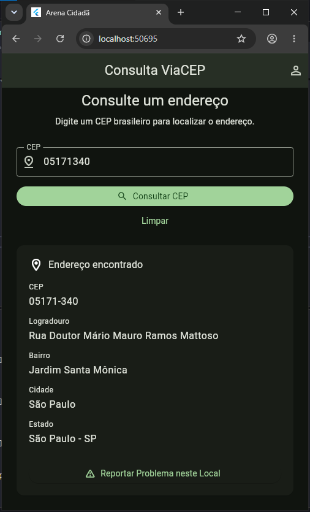
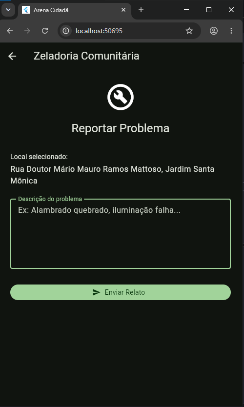
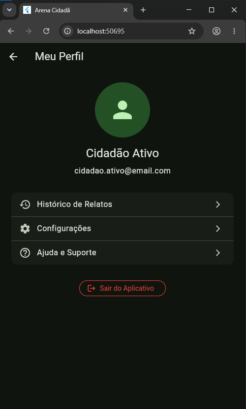
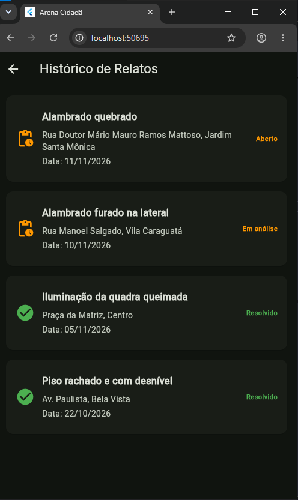
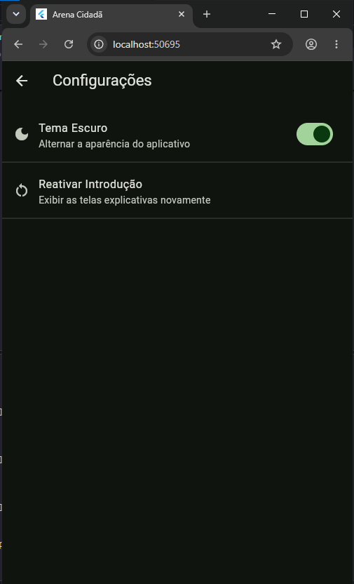

# Arena Cidadã - Global Solution 2026.2

# Identificação dos Desenvolvedores

- **RM:** 559875 - **Nome Completo:** Luciano Henrique Gonçalves D’Oliveira

- **RM:** 559201 - **Nome Completo:** Matheus Rocha Sousa

## Tema da Global Solution

**CitizenTech** - Tecnologias criadas a partir das necessidades reais das pessoas para melhorar a vida nas cidades e comunidades.
O projeto "Arena Cidadã" está alinhado diretamente com os **ODS 3 (Saúde e Bem-estar)** e **ODS 11 (Cidades e comunidades sustentáveis)**.

## Descrição da Solução

O **Arena Cidadã** é um aplicativo multiplataforma focado na democratização e gestão inteligente de espaços esportivos públicos (como quadras, pistas e campos comunitários). O objetivo é transformar espaços muitas vezes ociosos ou monopolizados em polos ativos de integração. A plataforma permite que os moradores consultem locais, acompanhem o status e relatem problemas de infraestrutura nestes espaços (Zeladoria Comunitária), promovendo a manutenção participativa e acionando o poder público de forma inteligente e geolocalizada.

## Explicação da Arquitetura

O projeto foi estruturado seguindo boas práticas de separação de responsabilidades e modularização exigidas na disciplina de desenvolvimento mobile, utilizando o padrão nativo `setState` e `ValueNotifier` para o gerenciamento de estados.

A estrutura de pastas está dividida da seguinte forma:

- `lib/components/`: Centraliza os widgets reaproveitáveis visando manter as telas limpas (ex: `EnderecoCard`).

- `lib/model/`: Classes de mapeamento e tipagem forte de dados para conversão de JSON (`Endereco`, `Quadra`, `Relato`).

- `lib/repository/`: Camada exclusiva de acesso a dados. Centraliza a comunicação com APIs externas (`viacep_repository.dart`) e o armazenamento de estado local em memória (`relato_repository.dart`), blindando a interface de regras de negócio.

- `lib/navigation/`: Arquivos de roteamento centralizado (`app_routes.dart` e `app_navigation.dart`), seguindo o padrão `onGenerateRoute`.

- `lib/screens/`: Telas principais e fluxos do usuário (Stateless e Stateful Widgets).

## API Utilizada

Utilizamos a **API Pública ViaCEP** (`https://viacep.com.br/ws/`) na tela de Zeladoria Comunitária/Consulta. Ao informar o CEP do espaço esportivo ou praça que apresenta problemas estruturais, o aplicativo consome o WebService via pacote `http`. O código trata rigorosamente os 4 estados da requisição (Inicial, Carregamento, Sucesso e Erro), converte o JSON em um objeto Dart e preenche os dados automaticamente, oferecendo opções de recarregamento amigáveis em caso de falha de conexão.

## Fluxo de Telas

1. **Splash Screen:** Exibição do logo (`Image.asset`), transição automática e verificação de primeiro acesso usando `SharedPreferences`.

2. **Onboarding:** Apresentação da proposta de valor com persistência da preferência "Não mostrar novamente".

3. **Home:** Tela principal com campo numérico e validações para consumo e consulta da API REST.

4. **Reportar Problema:** Formulário interativo acessado através de passagem de parâmetros (objeto `Endereco`).

5. **Perfil:** Painel do cidadão com opções de navegação complementares.

6. **Histórico:** Lista dinâmica consumindo dados de ocorrências salvas temporariamente no `RelatoRepository`.

7. **Configurações:** Controle de injeção de dependência para mudança global de tema (Claro/Escuro) e reset do Onboarding.

8. **Ajuda e Suporte:** Informações de contato usando o componente visual `ListView.builder`.

## Prints das Telas

**Splash Screen:**

- 

**Onboarding:**

- 
- 
- 

**Home:**

- 
- 

**Reportar Problema:**

- 

**Perfil:**

- 

**Histórico:**

- 

**Configurações:**

- 

**Ajuda e Suporte:**

- 
